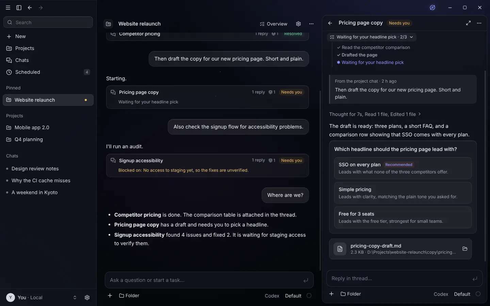
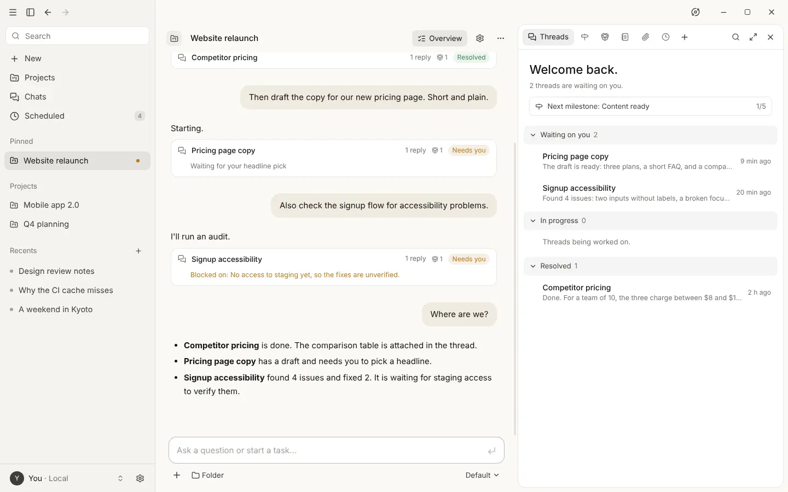
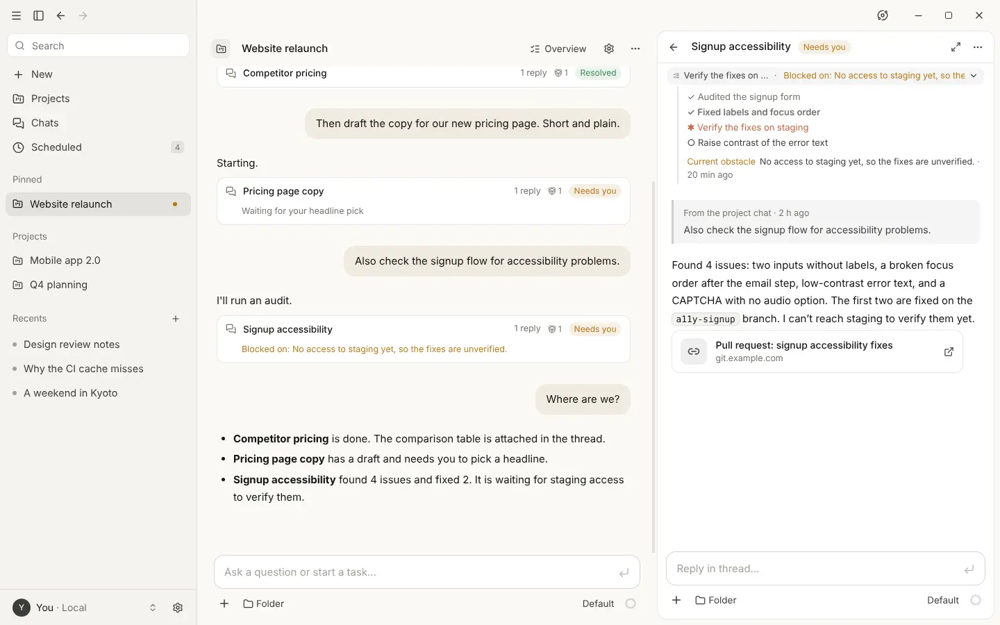
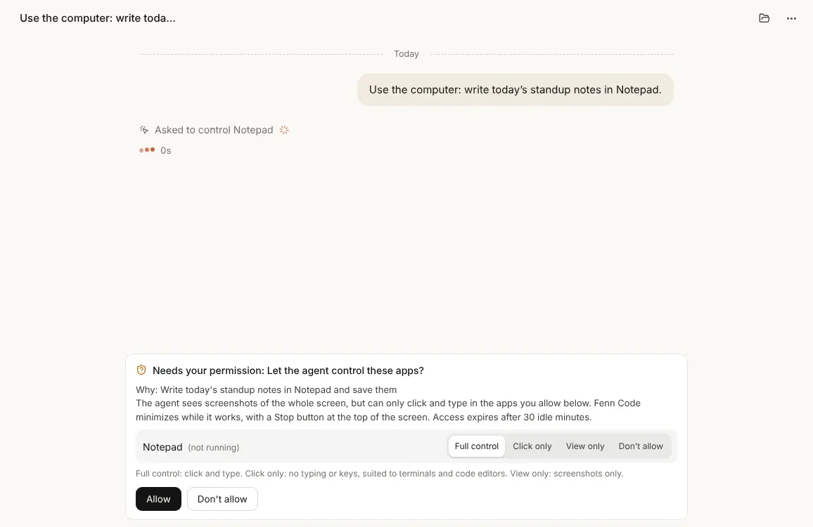
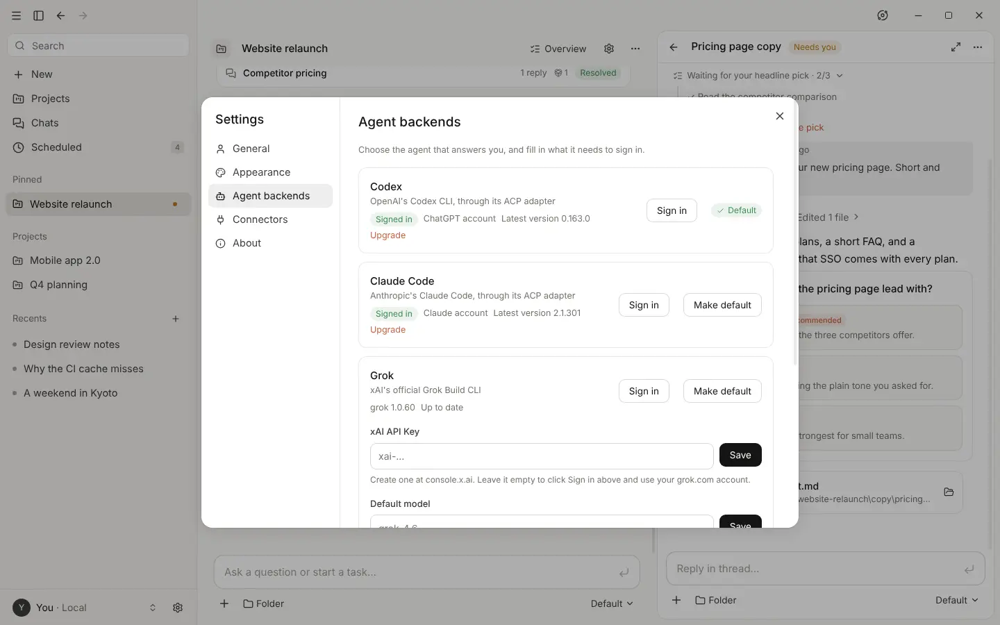
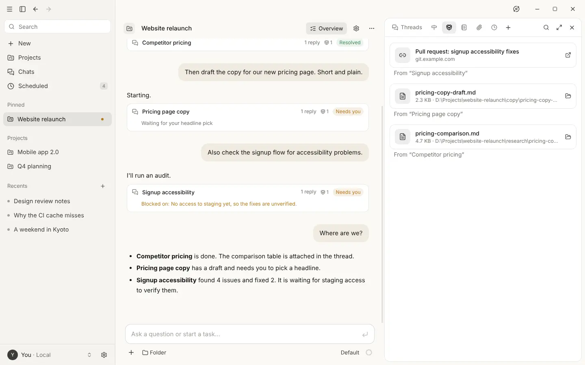
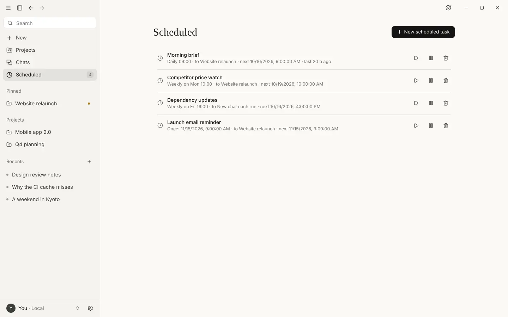
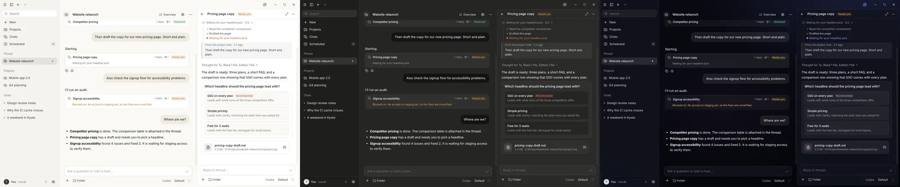

# Ancora

**A desktop workspace for the AI agents you already use.** Chats, projects that split work into threads, scheduled tasks and computer use, on top of Codex, Claude Code, Grok, Qoder or any agent that speaks the [Agent Client Protocol](https://agentclientprotocol.com).

[简体中文](README.zh.md) · [Download](../../releases) · [Build from source](#build-from-source)



> **Unofficial.** Ancora is an independent open-source project. It is not affiliated with, endorsed by or sponsored by Anthropic. "Claude" is a trademark of Anthropic. Ancora does not include or call Claude by itself; it borrows the look and workflow of the Claude desktop app and runs whichever agent you connect.

## Why Ancora

Command-line agents are good at the work but leave you with a terminal per task. Ancora gives them the structure of a desktop app: one place to ask, threads that keep long work apart, a record of what was decided and what was produced, and tasks that run on a schedule. The agent stays your choice, and switching agents doesn't lose the project.

## Features

### Projects with threads

A project has its own chat, run by a coordinator agent. It answers small questions itself and starts a **thread** for anything that takes real work. Each thread keeps a live checklist, names its current obstacle, and asks for a decision with a card when it needs one. An overview shows what is waiting on you, what is in progress and what is done, next to a progress board of milestones the agents keep up to date.

Project memory, files and progress belong to the project, not to an agent session, so a new session (or another backend) picks up where the last one left off.

<p>
  
  
</p>

### Computer use

With computer use switched on, an agent whose model can read images works in your other apps: it takes screenshots, clicks, types, scrolls and opens programs. It has to ask for each app first, and you choose **full control**, **click only** or **view only** per app. Clicks are checked against the app under the pointer, Ancora steps aside while it works, and a bar at the top of the screen shows what it is doing and stops it.



### Any ACP agent, four built in

Codex, Claude Code, Grok and Qoder are built in, and Codex is the suggested default when it is installed. Settings shows whether each one is installed and, where the agent reports it, signed in. It checks for updates and upgrades only when you ask. Any other ACP agent is one entry in `backends.json`.

Ancora never installs an agent on its own. The install and upgrade buttons show the exact command and wait for you to confirm, and the model picker only lists agents that are ready to use.



### Outputs

When an agent hands over a file or a link, it shows up as a card under its reply and in the project's **Outputs** library, with the thread it came from. Files open in their default app.



### Scheduled tasks

Run a prompt once, every few minutes, daily, weekly or on a cron schedule, and have the result posted to a project, a conversation or a fresh chat. Agents can set up their own scheduled tasks when work needs to repeat.



### Themes and languages

Light, dark and a translucent Glass theme, in English or Simplified Chinese. The language follows your system until you pick one in Settings → General.



Also included: attachments, editing and regenerating with version history, token and cost usage as the backend reports it, working folders with file and terminal tools, MCP connectors, full-text search, automatic filing of loose chats into projects, and desktop notifications.

## Quick start

1. Download `Ancora-0.1.0-win.zip` from [Releases](../../releases), unzip it anywhere and run `Ancora.exe`. The build is not code-signed yet, so Windows SmartScreen may ask first: choose **More info → Run anyway**.
2. Install and sign in to at least one agent, in a terminal or from Settings → Agent backends:

   | Agent | Install | Sign in | Status |
   |---|---|---|---|
   | Codex (recommended) | `npm install -g @openai/codex @agentclientprotocol/codex-acp` | `codex login` | Tested end to end on Windows 11 |
   | Claude Code | `npm install -g @anthropic-ai/claude-code @agentclientprotocol/claude-agent-acp` | `claude auth login` | Supported through `claude-agent-acp`; connection verified (start-up and model list), full chat not yet tested |
   | Grok | `npm install -g @xai-official/grok` | **Sign in** in Settings, or an xAI API key | Supported |
   | Qoder | `npm install -g @qoder-ai/qodercli` | `qodercli login`, or a personal access token | Supported |

   Codex and Claude Code connect through their ACP adapters, which is why each needs a second package. Behind a proxy, set `HTTPS_PROXY` (and `NODE_USE_ENV_PROXY=1`) in the same terminal first.
3. A short first-run guide asks what to call you and which agent to use. Every step can be skipped.

## Platforms

| Platform | Status |
|---|---|
| Windows 11 (x64) | Prebuilt release. Tested, including computer use. Windows 10 should work but has not been tested. |
| macOS | Build from source with `build.sh`. Not yet verified on hardware; feedback welcome. Computer use needs the Accessibility and Screen Recording permissions. |
| Linux | Build from source with `build.sh`. Not yet verified on desktop hardware; feedback welcome. Computer use needs an X11 session and `xdotool` (Wayland isn't supported). |

## Build from source

You need [Node.js](https://nodejs.org) 22 or newer and git. Clone this repository, then run one command in it:

| OS | Command |
|---|---|
| Windows | `.\build.cmd -Run` (double-clicking `build.cmd` builds without starting the app) |
| macOS / Linux | `./build.sh --run` |

The script checks Node.js, installs dependencies, builds the app and prints where it is (`release/win-unpacked/Ancora.exe`, `release/mac*/Ancora.app` or `release/linux-unpacked/ancora-desktop` on x64; other architectures get their own folder). Add `-Installer` (Windows) or `--installer` (macOS / Linux) to also build an installer. Behind a proxy, set `HTTPS_PROXY` first and the scripts pass it on to Node's own downloads.

On macOS, an app you built yourself opens with right-click → **Open** the first time.

## Adding a backend

Without code, add the agent to `backends.json` in the app's data folder (`%APPDATA%\Ancora` on Windows, `~/Library/Application Support/Ancora` on macOS, `~/.config/Ancora` on Linux), or open it from Settings → Agent backends → Advanced:

```json
[
  {
    "id": "my-agent",
    "name": "My Agent",
    "command": "my-agent",
    "args": ["--acp"],
    "settings": [{ "key": "MY_AGENT_API_KEY", "label": "API Key", "secret": true }],
    "login": { "command": "my-agent", "args": ["login"] },
    "upgrade": {
      "run": { "command": "npm", "args": ["install", "-g", "my-agent@latest"] },
      "latest": { "command": "npm", "args": ["view", "my-agent", "version"] }
    }
  }
]
```

`settings` become fields in Settings (secrets are encrypted with the OS keychain) and reach the agent as environment variables. `login` adds a **Sign in** button that runs the command in a terminal, and `upgrade` adds an **Upgrade** button that asks before running. Click **Reload** after editing; only the entries you changed restart.

With code, add a file to `src/main/backends/plugins/`, and it is picked up automatically:

```ts
import { acpPlugin } from '../acp'

export default acpPlugin({
  id: 'myagent',
  name: 'My Agent',
  settings: [{ key: 'API_KEY', label: 'API Key', secret: true }],
  launch: ({ config }) => ({ command: 'myagent', args: ['acp'], env: { API_KEY: config.API_KEY } })
})
```

A backend that doesn't speak ACP implements `AgentBackend` from `src/shared/contract.ts` and exports a `BackendPlugin`. The rest of the app only ever sees that contract.

## How it works

```
renderer (React)  ──IPC──▶  AppCore ─┬─ ChatService ── BackendManager ──▶ plugin ──▶ agent
                                     ├─ Orchestrator (projects, threads)
                                     ├─ AutoAssigner (titles, filing)
                                     ├─ Scheduler (scheduled tasks)
                                     └─ ToolServer (MCP tools the agents call)
```

Project features (threads, checklists, memory, progress, outputs, computer use) reach agents as MCP tools served by the app, so they work with any backend that can pass tools to its agent. `src/main/backends/acp/` is the only code that knows about ACP.

## Development

```bash
npm install
npm run dev          # run with hot reload
npm test             # unit and integration tests, against a built-in demo agent
npm run typecheck
npm run build && xvfb-run -a node scripts/e2e.mjs   # UI checks with Playwright (Linux)
npm run dist         # package for the current OS into release/
```

Translations live in [`src/shared/i18n`](src/shared/i18n/README.md); adding a language mostly means adding one file. The README screenshots come from `scripts/readme-shots.mjs`, which stages a demo with no real agent or personal data. See [CONTRIBUTING.md](CONTRIBUTING.md) before opening a pull request.

## License

[MIT](LICENSE). Ancora is not affiliated with Anthropic, OpenAI, xAI or Qoder; product names belong to their owners.
