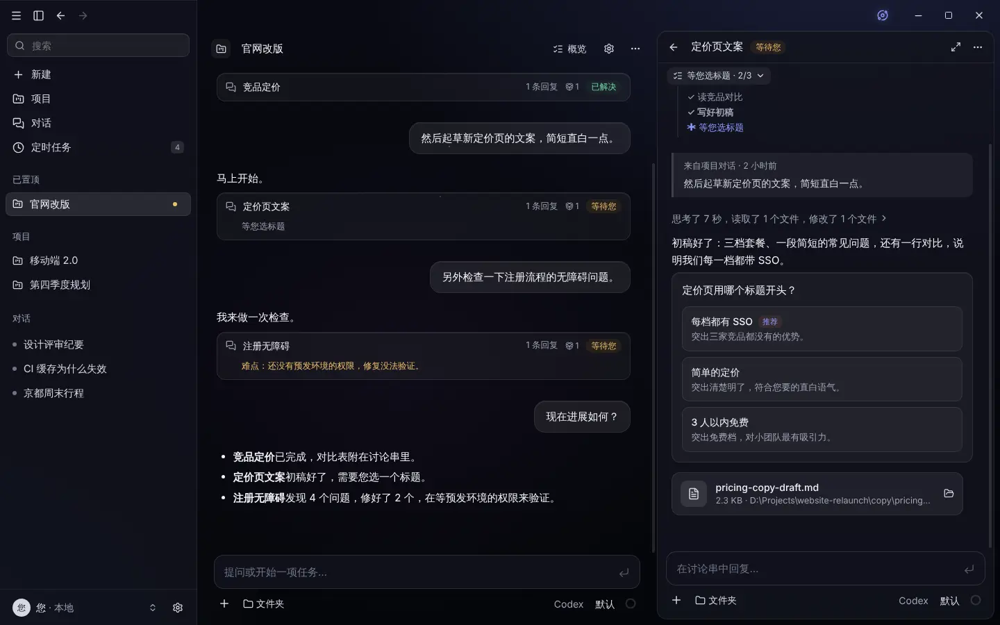
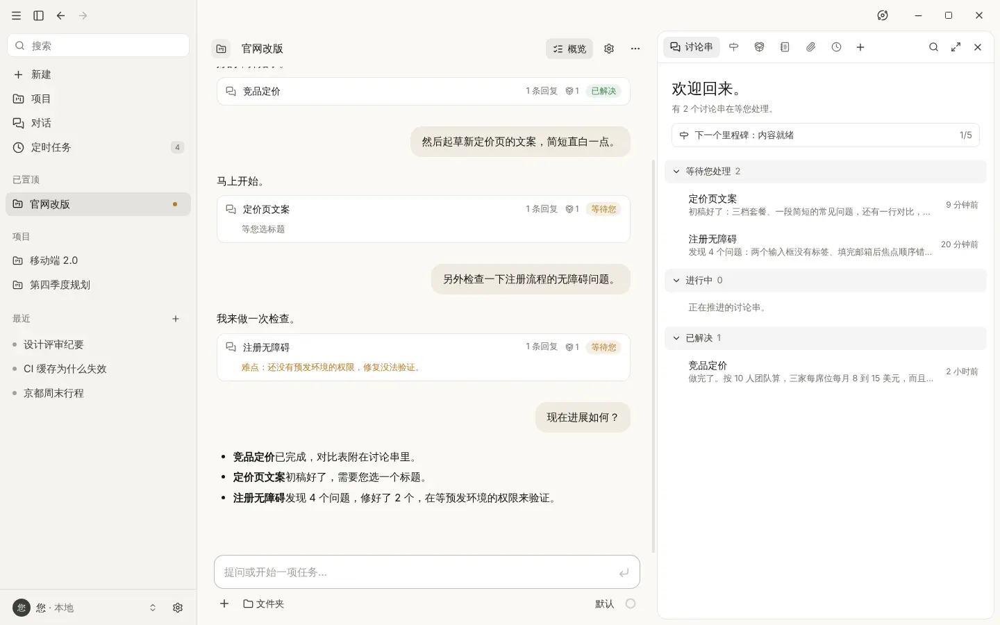
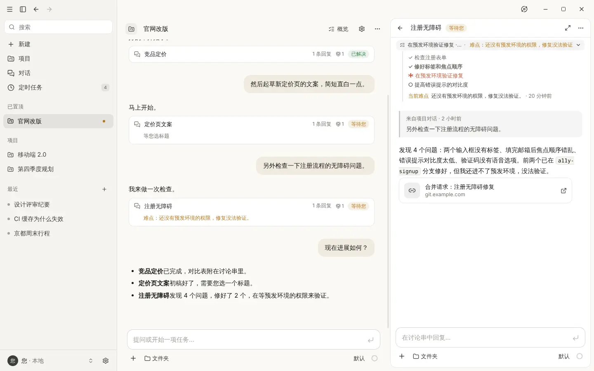
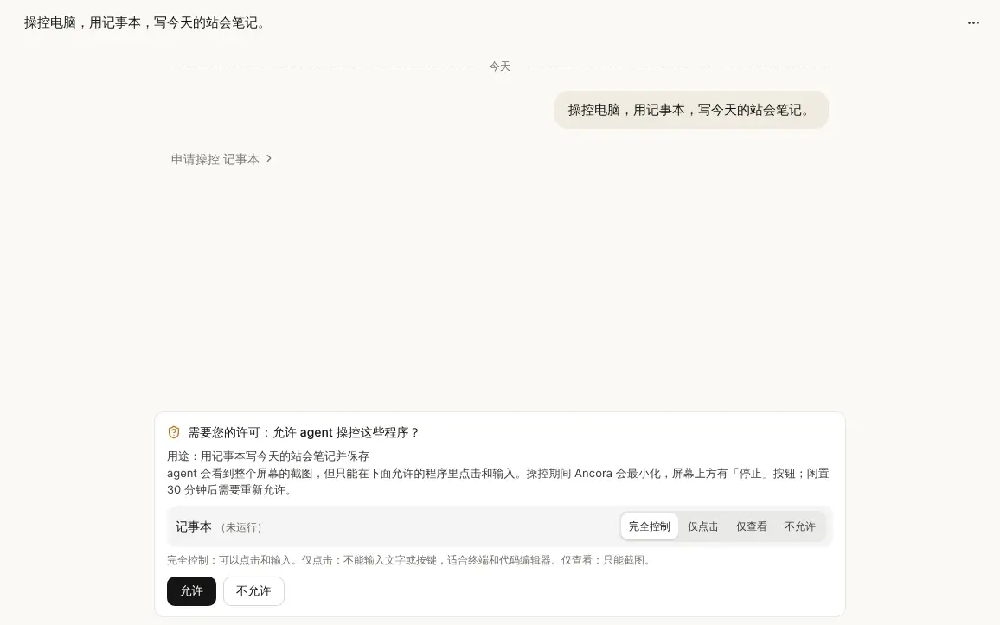
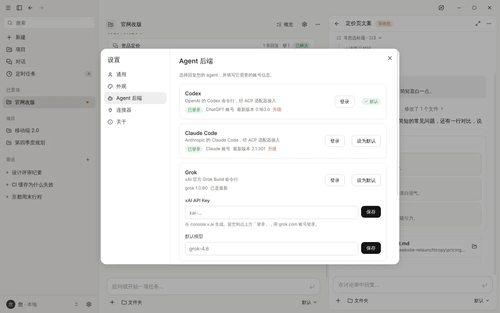
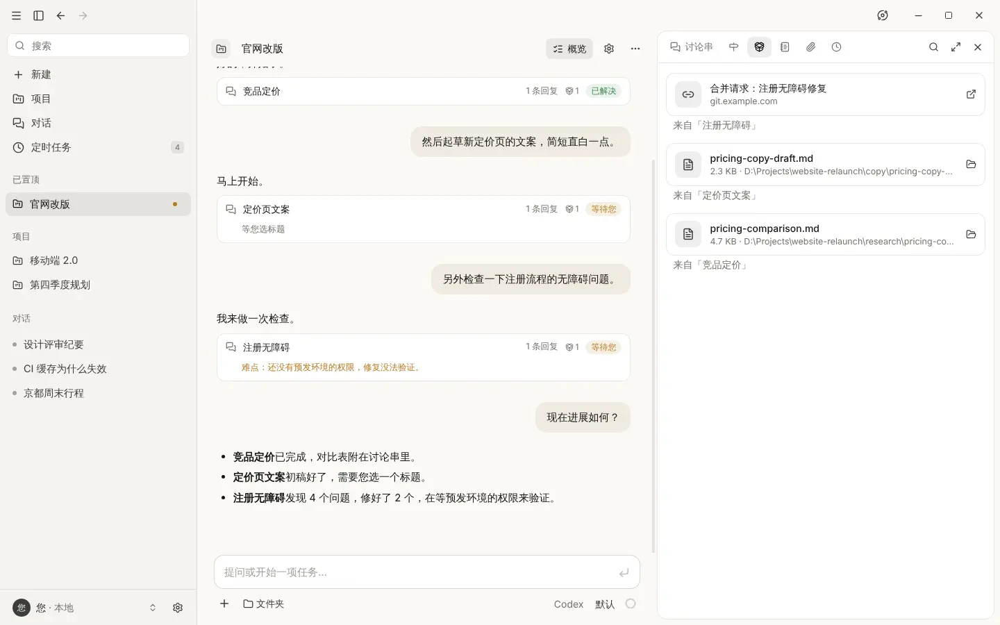
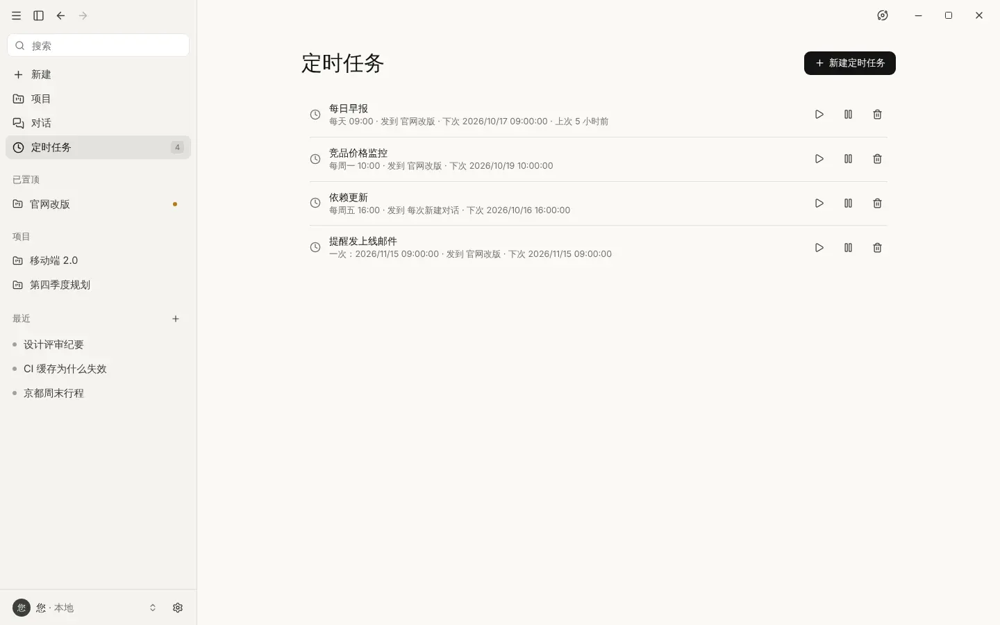
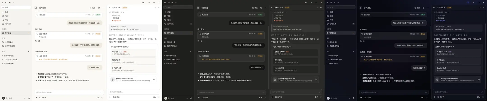

# Ancora

**为您已经在用的 AI agent 准备的桌面工作台。** 对话、能把工作拆成讨论串的项目、定时任务和电脑操控，背后可以是 Codex、Claude Code、Grok、Qoder，或任何支持 [Agent Client Protocol](https://agentclientprotocol.com)（ACP）的 agent。

[English](README.md) · [下载](../../releases) · [从源码编译](#从源码编译)



> **非官方项目。** Ancora 是独立的开源项目，与 Anthropic 没有任何关系，也没有得到 Anthropic 的认可或赞助。「Claude」是 Anthropic 的商标。Ancora 本身不包含也不调用 Claude，它参照了 Claude 桌面版的外观和用法，运行的是您接入的 agent。

## 为什么做 Ancora

命令行 agent 干活很强，但每件事都得开一个终端。Ancora 给它们一个桌面应用该有的结构：一个地方提需求，长任务各自放在讨论串里，做过的决定和交付的成果都有记录，需要反复做的事按时自动运行。用哪个 agent 由您决定，换一个 agent，项目也不会丢。

## 功能

### 项目和讨论串

每个项目有自己的主对话，由一个协调 agent 负责。小问题它直接回答，要花功夫的工作就开一个**讨论串**去做。每个讨论串都有实时更新的进度清单，会写明当前难点，需要您拍板时发一张选择卡片。概览页列出哪些在等您、哪些在进行、哪些已完成，旁边还有 agent 随时更新的里程碑进度表。

项目记忆、项目文件和进度都属于项目本身，不依赖某个 agent 会话。换一个新会话，甚至换一个后端，也能接着做。

<p>
  
  
</p>

### 操控电脑

打开电脑操控后，模型能看图的 agent 可以在您的其他程序里干活：截屏、点击、输入、滚动、打开程序。它必须先申请要用的程序，您可以给每个程序选**完全控制**、**仅点击**或**仅查看**。点击前会核对指针下是不是被允许的程序；操控期间 Ancora 会自动让开，屏幕上方的横条显示它在做什么，随时可以停止。



### 任意 ACP agent，内置四个

内置 Codex、Claude Code、Grok 和 Qoder，装了 Codex 时默认推荐它。设置里能看到每个 agent 是否已安装，以及在 agent 能报告时是否已登录。只有您点了才会检查更新和升级。其他 ACP agent 在 `backends.json` 里加一项即可。

Ancora 从不自行安装 agent。安装和升级按钮会先显示要运行的确切命令，等您确认后才执行；选择模型时也只列出已经可用的 agent。



### 成果

agent 交付的文件或链接会显示成回复下方的卡片，同时汇总到项目的「成果」页，并注明来自哪个讨论串。文件用系统默认程序打开。



### 定时任务

让一段指令只运行一次，或每隔几分钟、每天、每周、按 cron 表达式运行，结果发到项目、某个对话或每次新建的对话里。工作需要反复做时，agent 也会自己建定时任务。



### 主题和语言

浅色、深色和半透明的太空玻璃主题，界面支持简体中文和英文。语言默认跟随系统，也可以在 设置 → 通用 里切换。



此外还有：附件、编辑和重新生成（保留历史版本）、按后端上报显示的 token 用量和费用、带文件和终端工具的工作文件夹、MCP 连接器、全文搜索、零散对话自动归入项目，以及桌面通知。

## 快速开始

1. 从 [Releases](../../releases) 下载 `Ancora-0.1.0-win.zip`，解压到任意位置，运行 `Ancora.exe`。程序暂时没有代码签名，Windows SmartScreen 可能会拦一下，点「更多信息 → 仍要运行」即可。
2. 至少安装并登录一个 agent，在终端里做，或者在 设置 → Agent 后端 里点按钮：

   | Agent | 安装 | 登录 | 状态 |
   |---|---|---|---|
   | Codex（推荐） | `npm install -g @openai/codex @agentclientprotocol/codex-acp` | `codex login` | 已在 Windows 11 上完整实测 |
   | Claude Code | `npm install -g @anthropic-ai/claude-code @agentclientprotocol/claude-agent-acp` | `claude auth login` | 通过 `claude-agent-acp` 接入；已验证连接（启动和模型列表），完整对话尚未实测 |
   | Grok | `npm install -g @xai-official/grok` | 在设置里点「登录」，或填 xAI API Key | 支持 |
   | Qoder | `npm install -g @qoder-ai/qodercli` | `qodercli login`，或填个人访问令牌 | 支持 |

   Codex 和 Claude Code 通过 ACP 适配器接入，所以各需要两个包。在国内网络下，可以先在同一个终端里设好 `HTTPS_PROXY`，并设 `NODE_USE_ENV_PROXY=1`，让 npm 和 Node 走代理。
3. 第一次打开时会有简短的引导，问您怎么称呼、用哪个 agent。每一步都可以跳过。

## 支持的平台

| 平台 | 状态 |
|---|---|
| Windows 11（x64） | 提供预编译版本，已实测，包括电脑操控。Windows 10 理论上可用，尚未测试。 |
| macOS | 用 `build.sh` 从源码编译。尚未在真机上验证，欢迎反馈。电脑操控需要「辅助功能」和「录屏与系统录音」权限。 |
| Linux | 用 `build.sh` 从源码编译。尚未在桌面真机上验证，欢迎反馈。电脑操控需要 X11 会话和 `xdotool`（不支持 Wayland）。 |

## 从源码编译

需要 [Node.js](https://nodejs.org) 22 或更新版本，以及 git。克隆本仓库后，在仓库目录里运行一条命令：

| 系统 | 命令 |
|---|---|
| Windows | `.\build.cmd -Run`（双击 `build.cmd` 只编译，不会启动程序） |
| macOS / Linux | `./build.sh --run` |

脚本会检查 Node.js、安装依赖、编译，最后打印程序位置（`release\win-unpacked\Ancora.exe`、`release/mac*/Ancora.app` 或 x64 上的 `release/linux-unpacked/ancora-desktop`，其他架构会有各自的目录）。要同时生成安装包，加 `-Installer`（Windows）或 `--installer`（macOS / Linux）。需要代理时，先设好 `HTTPS_PROXY`，脚本会让 Node 自己的下载也走代理。

在 macOS 上，自己编译的程序第一次打开时请右键点它，选「打开」。

## 接入新的后端

不写代码：在应用数据目录（Windows 是 `%APPDATA%\Ancora`，macOS 是 `~/Library/Application Support/Ancora`，Linux 是 `~/.config/Ancora`）的 `backends.json` 里加一项，也可以从 设置 → Agent 后端 → 高级 打开它：

```json
[
  {
    "id": "my-agent",
    "name": "My Agent",
    "command": "my-agent",
    "args": ["--acp"],
    "settings": [{ "key": "MY_AGENT_API_KEY", "label": "API Key", "secret": true }],
    "login": { "command": "my-agent", "args": ["login"] },
    "upgrade": {
      "run": { "command": "npm", "args": ["install", "-g", "my-agent@latest"] },
      "latest": { "command": "npm", "args": ["view", "my-agent", "version"] }
    }
  }
]
```

`settings` 会变成设置里的输入框（密钥用系统钥匙串加密），以环境变量的形式传给 agent。`login` 会加一个「登录」按钮，在终端里运行那条命令；`upgrade` 会加一个「升级」按钮，运行前先征求您同意。改完点「重新加载」，只有改动过的项会重启。

写代码：在 `src/main/backends/plugins/` 里加一个文件，会被自动加载：

```ts
import { acpPlugin } from '../acp'

export default acpPlugin({
  id: 'myagent',
  name: 'My Agent',
  settings: [{ key: 'API_KEY', label: 'API Key', secret: true }],
  launch: ({ config }) => ({ command: 'myagent', args: ['acp'], env: { API_KEY: config.API_KEY } })
})
```

不支持 ACP 的后端，实现 `src/shared/contract.ts` 里的 `AgentBackend` 并导出一个 `BackendPlugin` 即可。应用的其余部分只认这个约定。

## 工作原理

```
renderer (React)  ──IPC──▶  AppCore ─┬─ ChatService ── BackendManager ──▶ plugin ──▶ agent
                                     ├─ Orchestrator（项目、讨论串）
                                     ├─ AutoAssigner（标题、自动归类）
                                     ├─ Scheduler（定时任务）
                                     └─ ToolServer（agent 调用的 MCP 工具）
```

讨论串、进度清单、项目记忆、进度表、成果和电脑操控，都以应用提供的 MCP 工具的形式交给 agent，所以只要后端能把工具传给 agent 就能用。`src/main/backends/acp/` 是唯一和 ACP 打交道的代码。

## 开发

```bash
npm install
npm run dev          # 带热重载运行
npm test             # 单元和集成测试，用内置的演示 agent
npm run typecheck
npm run build && xvfb-run -a node scripts/e2e.mjs   # 用 Playwright 做界面检查（Linux）
npm run dist         # 打包当前系统的版本到 release/
```

界面文字都在 [`src/shared/i18n`](src/shared/i18n/README.md)，新增一种语言主要就是加一个文件。README 里的截图由 `scripts/readme-shots.mjs` 生成，用的是演示数据，不运行真实 agent，也不含个人信息。提交合并请求前请先看 [CONTRIBUTING.md](CONTRIBUTING.md)。

## 许可

[MIT](LICENSE)。Ancora 与 Anthropic、OpenAI、xAI、Qoder 均无关联，相关产品名称归各自所有者。
