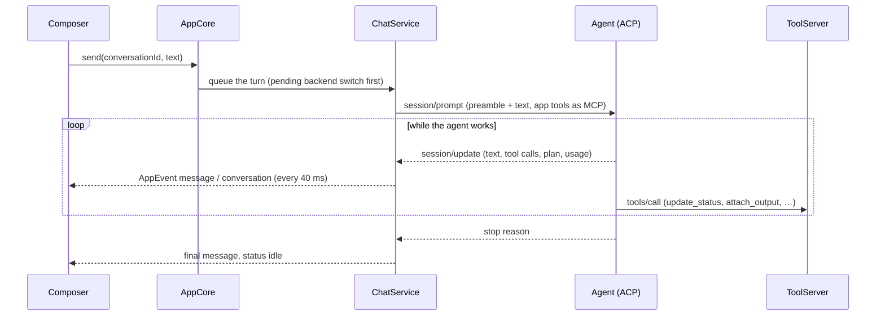
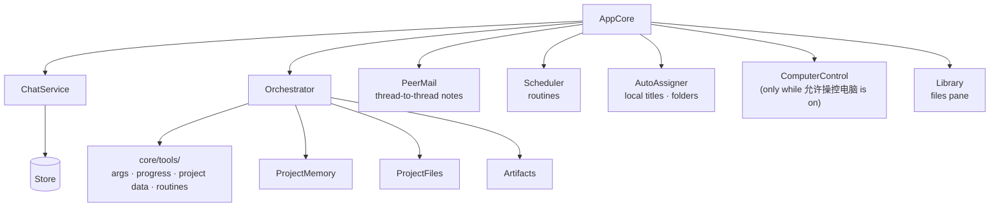

# How Fenn Code is put together

Fenn Code is an Electron app. Its main process owns all state and talks to agent backends over ACP. The renderer (React) only shows that state and calls the core.


A turn, from the user's Enter to the reply on screen:



Who keeps what (each part registers with `chat.removedListeners` to forget a deleted conversation):



## Where things live

| Area | Place | Notes |
|---|---|---|
| API between renderer and core | `src/shared/model.ts` (`FennApi`), `src/shared/ipc.ts` (`API_METHODS`) | See "Adding an API method" |
| Core facade | `src/main/core/AppCore.ts` | Every API method is an AppCore method of the same name |
| Turns, sessions, streaming | `src/main/core/ChatService.ts` | One conversation's agent session, queue, permissions, spare sessions |
| Chat titles and folders | `src/main/core/AutoAssigner.ts`, `src/main/core/titles.ts` | Titles made locally (`localTitle`); no agent is asked |
| Prompts and app tools | `src/main/core/Orchestrator.ts`, `src/main/core/tools/*` | Tool families are plain functions of their deps |
| Persistence | `src/main/store/Store.ts` | Debounced, atomic JSON files; lookups by id |
| Backends | `src/main/backends/` | ACP adapter (`acp/`), one plugin file per built-in backend in `plugins/` (Codex, Claude Code, Grok, Antigravity, Qoder), `backends.json` entries in `registry.ts` |
| Renderer state | `src/renderer/src/store.ts` | Applies AppEvents; `toast`, `toastError` |
| Shared renderer actions | `src/renderer/src/actions.ts`, `routes.ts` | Deleting chats and projects, where a conversation opens |
| Styles | `src/renderer/src/tokens.css`, `styles.css` → `styles/NN-area.css` | Files load in cascade order; values come from tokens. Motion: `--ease` and `--dur-1/2/3`, entrances in `19-motion.css` |
| Strings | `src/shared/i18n/` | `node scripts/i18n-add.mjs '{"中文":"English"}'` |
| New-chat page widgets | `src/renderer/src/widgets/` | One file per widget in `builtin/`; see "Adding a widget" |

## Adding an API method

1. Declare it on `FennApi` in `src/shared/model.ts`.
2. Add its name to `API_METHODS` in `src/shared/ipc.ts`.
3. Write the AppCore method with the same name.

The compiler checks the rest:
- a method missing from the list fails in `ipc.ts`;
- a method missing from AppCore, or one whose parameters don't match, fails in `src/main/index.ts`.

The preload and the IPC handlers come from the list, so you don't touch them. Errors reach the renderer as the core's own message: use `.catch(toastError)`.

## Adding a widget

The new-chat page is laid out like a chat: the composer sits where a chat's does, and the room above holds widgets (usage figures, the daily heatmap, the most used models). Each widget is self-contained: it fetches what it shows (`widgets/usage.ts` shares one usage fetch among them) and renders inside `WidgetCard`, or renders nothing while it has nothing to show.

1. Add `src/renderer/src/widgets/builtin/<name>.tsx` whose default export is a `Widget` (`registry.ts`): an `id`, a `title` for the menus, `size` `'wide'` or `'half'`, an `order` among the built-ins, and its `Component`.
2. That is all: built-ins are found at build time. Code that loads later (a plugin) calls `registerWidget(widget)`, which also replaces a widget with the same id and returns a function that removes it.

The user's layout is `settings.homeWidgets` (ids in order; unset shows every widget). Each card's 「…」 menu moves, removes, adds and restores widgets. A widget that throws disappears instead of taking the page with it.

## Adding a tool for agents

Put a tool family in `src/main/core/tools/<family>.ts`. It is a function `(deps, …) => ToolDef[]`, where `deps` names exactly what the family uses. Use `obj` and `str` from `tools/args.ts` for schemas and arguments.

Register the family in `Orchestrator.baseTools`, or in AppCore's `extraTools` when the core owns its data.

A thread's tool list counts against `test/prompt-size.test.ts`. That test measures the real `tools/list` the agent receives, so keep descriptions short. List a tool only where it can work: for example, computer control's tools appear only while it is turned on.

## Working folders

A chat with no folder works in a private scratch folder (`ChatService.scratchPath`), where the agent reads, writes and runs commands freely. Anything outside the working folder goes through a permission prompt (`backends/workspace.ts`); in a chat with no folder of its own, that prompt also offers 「设为工作文件夹」 for the folder involved (its nearest `.git` project, when there is one). Choosing it sets the chat's folder; the next turn's session starts there and the scratch files move in without replacing the user's. A mode that trusts the agent (bypassPermissions, full-access) is not asked. A chat that only made files in scratch gets `Documents/Fenn Code/<title>` after its turn (`AppCore.placeChat`).

## Chat titles

`AutoAssigner.consider` runs after every turn of a plain chat. After the first exchange it names the chat with `localTitle` (`core/titles.ts`): the first sentence of the user's first message (its first line, when the sentence is too short to say anything), without openers such as "please" or "帮我", cut to about 20 CJK or 40 Latin characters. Until then the chat shows `titleFrom`, the start of that message. If that first message was only a greeting, the title is made once more from the next message with real content. No agent is asked, so naming a chat never spends the user's quota. A title the user typed (or a routine's name) is never replaced, and a title another chat already has gets a number.

The same pass attaches a chat that has no folder to a folder the app already knows, when every path its first turn's tool calls touched lies inside that one folder. It never files a chat into a project.

## Permissions

An agent's permission request reaches `ChatService.routePermission`. `autoAnswer` settles what needn't wait for the user:

- read, search, think and fetch tool calls go ahead;
- edits whose paths all lie inside the chat's own folder (its working folder, or its scratch folder) go ahead;
- in an unattended run (a scheduled task, a board card's refresh, and threads handed work from one) anything else is rejected at once, and a notice in the reply says what was skipped. `askUser`, the app's own questions, does the same.

Everything else is asked inline, in its chat: the conversation shows as waiting on the user until it is answered. A mode that trusts the agent (bypassPermissions, full-access) is not asked by the agent in the first place.

## Spare sessions

Opening a session takes seconds in some agents even when the process is already running (Antigravity creates its conversation on Google's side). A backend that says so (`AgentBackend.wantsSpare`, from the `spareSession` quirk) gets one session opened ahead per agent, in `ChatService.spares`. It is opened for the id the next new chat will take, with that chat's scratch folder, tools and system prompt, and what the agent sends meanwhile is kept for it.

- The new-chat page's model picker reads that session's models and options (`AppCore.fromSpare`) instead of opening one of its own.
- The next new chat with that agent and folder takes it (`claimSpare`); if the folder or system prompt no longer match, it is closed and a fresh session opens.
- After a chat takes it, the next spare opens once that chat's first reply is in, so it doesn't hold the reply up. Choosing another default model, or another folder on the new-chat page, closes it and opens a new one.

## Per-conversation state

A conversation is deleted only through `ChatService.removeConversation`. That method stops the turn and forgets the session, then calls every function in `chat.removedListeners`.

Anything that keeps a map keyed by conversation id registers a listener there to drop its entry. Don't add cleanup calls to `deleteConversation`.

## Renderer performance

Subscribe to the smallest slice that drives the view:
- `useApp((s) => s.x)` for one value;
- `useShallow` for a few values;
- never `useApp()` with no selector in a component that stays mounted.

Streaming replies update `messages` many times a second. A view that doesn't show messages must not select them.

Derive per-item data in one pass with `useMemo`, as the sidebar's `projectStats` does, not with a scan per row.

## Checks

```
npm run typecheck                         # tsc: strict, no unused locals
npm run style-check                       # raw values outside tokens (ratchet)
npm test                                  # vitest, against the demo agent
xvfb-run -a npm run test:e2e -- <dir>     # build, then Playwright UI checks; <dir> keeps screenshots
xvfb-run -a npm run visual                # screenshot regression (baselines from the Linux CI image)
npm run dist -- --publish never && xvfb-run -a npm run test:package
```

On macOS and Windows, drop `xvfb-run -a`. CI (`.github/workflows/build.yml`) runs typecheck and tests on all three systems, the UI checks on Linux, and packages and smoke-tests each.
