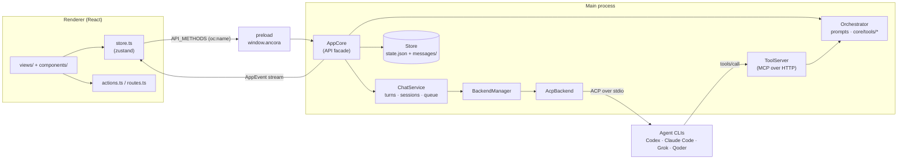
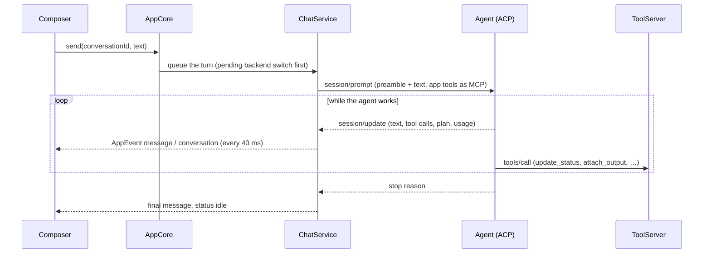
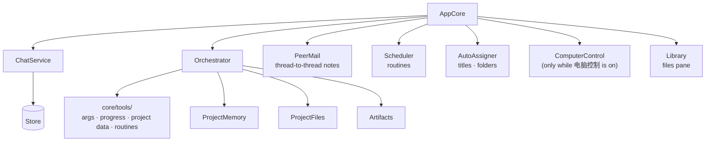

# How Ancora is put together

Ancora is an Electron app. Its main process owns all state and talks to agent backends over ACP. The renderer (React) only shows that state and calls the core.



A turn, from the user's Enter to the reply on screen:



Who keeps what (each part registers with `chat.removedListeners` to forget a deleted conversation):



## Where things live

| Area | Place | Notes |
|---|---|---|
| API between renderer and core | `src/shared/model.ts` (`AncoraApi`), `src/shared/ipc.ts` (`API_METHODS`) | See "Adding an API method" |
| Core facade | `src/main/core/AppCore.ts` | Every API method is an AppCore method of the same name |
| Turns, sessions, streaming | `src/main/core/ChatService.ts` | One conversation's agent session, queue, permissions |
| Prompts and app tools | `src/main/core/Orchestrator.ts`, `src/main/core/tools/*` | Tool families are plain functions of their deps |
| Persistence | `src/main/store/Store.ts` | Debounced, atomic JSON files; lookups by id |
| Backends | `src/main/backends/` | ACP adapter plus one plugin file per backend (see the README) |
| Renderer state | `src/renderer/src/store.ts` | Applies AppEvents; `toast`, `toastError` |
| Shared renderer actions | `src/renderer/src/actions.ts`, `routes.ts` | Deleting chats and projects, where a conversation opens |
| Styles | `src/renderer/src/tokens.css`, `styles.css` → `styles/NN-area.css` | Files load in cascade order; values come from tokens |
| Strings | `src/shared/i18n/` | `node scripts/i18n-add.mjs '{"中文":"English"}'` |

## Adding an API method

1. Declare it on `AncoraApi` in `src/shared/model.ts`.
2. Add its name to `API_METHODS` in `src/shared/ipc.ts`.
3. Write the AppCore method with the same name.

The compiler checks the rest:
- a method missing from the list fails in `ipc.ts`;
- a method missing from AppCore, or one whose parameters don't match, fails in `src/main/index.ts`.

The preload and the IPC handlers come from the list, so you don't touch them. Errors reach the renderer as the core's own message: use `.catch(toastError)`.

## Adding a tool for agents

Put a tool family in `src/main/core/tools/<family>.ts`. It is a function `(deps, …) => ToolDef[]`, where `deps` names exactly what the family uses. Use `obj` and `str` from `tools/args.ts` for schemas and arguments.

Register the family in `Orchestrator.baseTools`, or in AppCore's `extraTools` when the core owns its data.

A thread's tool list counts against `test/prompt-size.test.ts`. That test measures the real `tools/list` the agent receives, so keep descriptions short. List a tool only where it can work: for example, computer control's tools appear only while it is turned on.

## Per-conversation state

A conversation is deleted only through `ChatService.removeConversation`. That method stops the turn and forgets the session, then calls every function in `chat.removedListeners`.

Anything that keeps a map keyed by conversation id registers a listener there to drop its entry. Don't add cleanup calls to `deleteConversation`.

## Renderer performance

Subscribe to the smallest slice that drives the view:
- `useApp((s) => s.x)` for one value;
- `useShallow` for a few values;
- never `useApp()` with no selector in a component that stays mounted.

Streaming replies update `messages` many times a second. A view that doesn't show messages must not select them.

Derive per-item data in one pass with `useMemo`, as the sidebar's `projectStats` does, not with a scan per row.

## Checks

```
npx tsc --noEmit -p .          # strict, no unused locals
node scripts/style-check.mjs   # raw values outside tokens (ratchet)
npx vitest run
npx electron-vite build && xvfb-run -a node scripts/e2e.mjs <dir>
xvfb-run -a node scripts/visual.mjs
```
